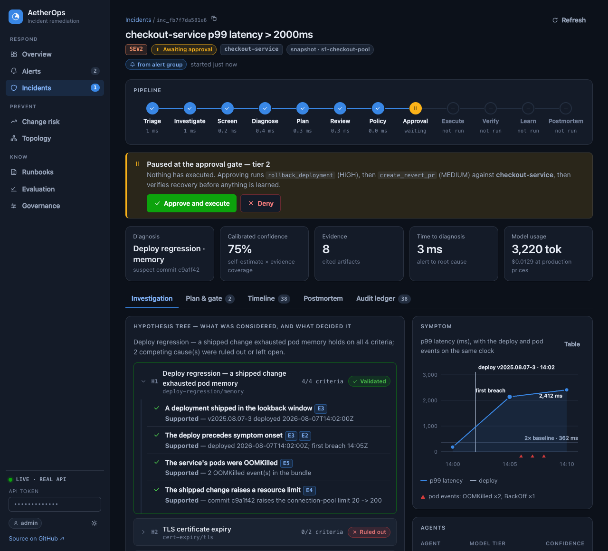

# AetherOps

[](https://github.com/Divya1S/Aether-Ops/actions/workflows/ci.yml)
&nbsp;**[Try the live demo →](https://divya1s.github.io/Aether-Ops/)**

AetherOps is an AI assistant for the engineers who get called when a live
system breaks. It works out what went wrong, shows the evidence behind its
answer, and proposes a fix. It never changes anything until a person approves.



## What it does

- **Cuts through alert noise.** One outage can set off dozens of alerts.
  AetherOps groups them into the few real problems (16 alerts become 3 in the
  demo) and points to where the trouble most likely started.
- **Finds the cause and shows its work.** It lists the possible causes and marks
  each one as confirmed, ruled out, or not enough evidence. Every claim links to
  the data behind it.
- **Asks before it acts.** It proposes a fix, such as undoing a bad update. You
  approve or deny. Nothing runs without a yes, and every step is recorded.
- **Says so when it doesn't know.** If the evidence doesn't add up, it hands the
  problem to a human instead of guessing.
- **Checks its own work.** After a fix it confirms the system recovered, then
  writes the incident report.
- **Warns about risky changes.** Before a code change goes out, it compares the
  change with past incidents and tells you how risky it looks.

## Try it

**In your browser:** open the [live demo](https://divya1s.github.io/Aether-Ops/).
There is nothing to install. It replays a recording of the real system.

**On your computer** (macOS or Linux, with Python 3.11 or newer):

```bash
git clone https://github.com/Divya1S/Aether-Ops.git
cd Aether-Ops
make serve
```

Then open http://127.0.0.1:8080 and:

1. Click **Simulate alert storm**.
2. Click **Investigate** on the first group.
3. Read what it found, then click **Approve and execute**.

You don't need an account, an API key, or any paid service.

## Other commands

| Command | What it does |
|---|---|
| `make demo` | Runs one incident from start to finish in the terminal |
| `make test` | Runs the tests |
| `make eval` | Checks how often it finds the right cause on a set of known incidents |
| `make demo-live` | Runs the demo with a free AI model on your own machine ([Ollama](https://ollama.com)) |

## Good to know

- **This is a portfolio project.** It runs on realistic sample incidents, not a
  real company's systems. Connections to GitHub and Prometheus are included and
  optional.
- **It works without an AI service.** By default it uses built-in rules in place
  of an AI model, so the demo and the tests behave the same everywhere.
- **It is tested.** 319 backend tests and 35 console tests run on every change.

Built with Python (standard library only), TypeScript and React.

## Learn more

- [See it working](DEMONSTRATION.md): a captured run, step by step
- [The console and alert grouping](docs/20-operator-console.md)
- [Technical overview](docs/21-technical-overview.md): the detailed version
- [Design documents](docs/): architecture, security, evaluation and more
